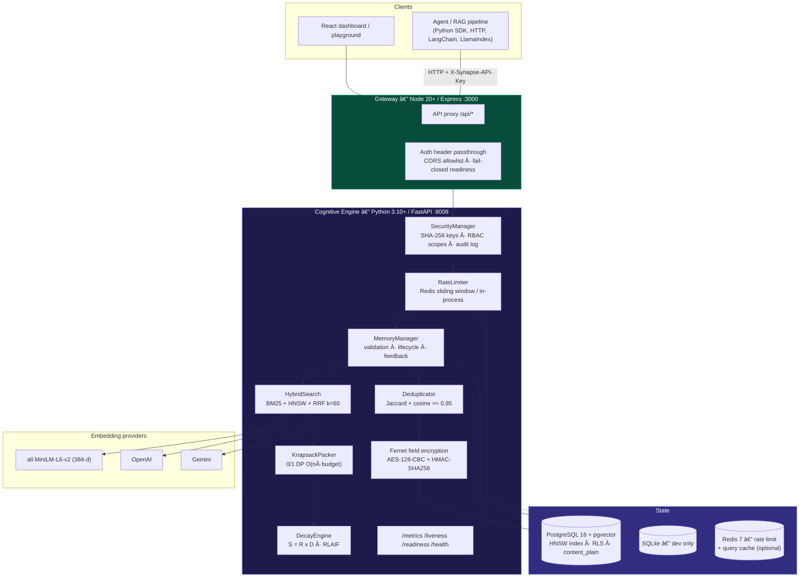
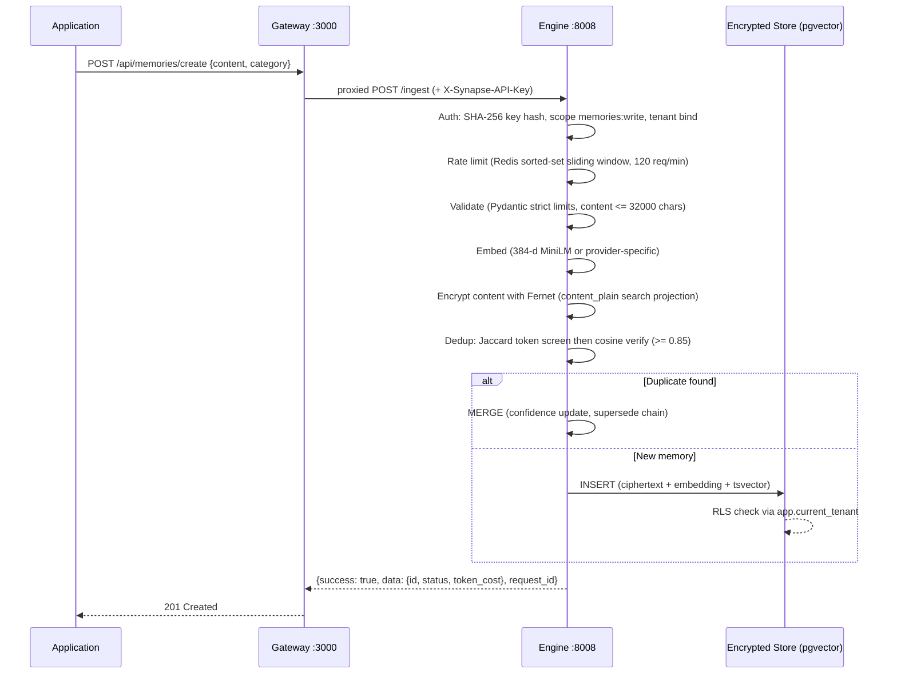
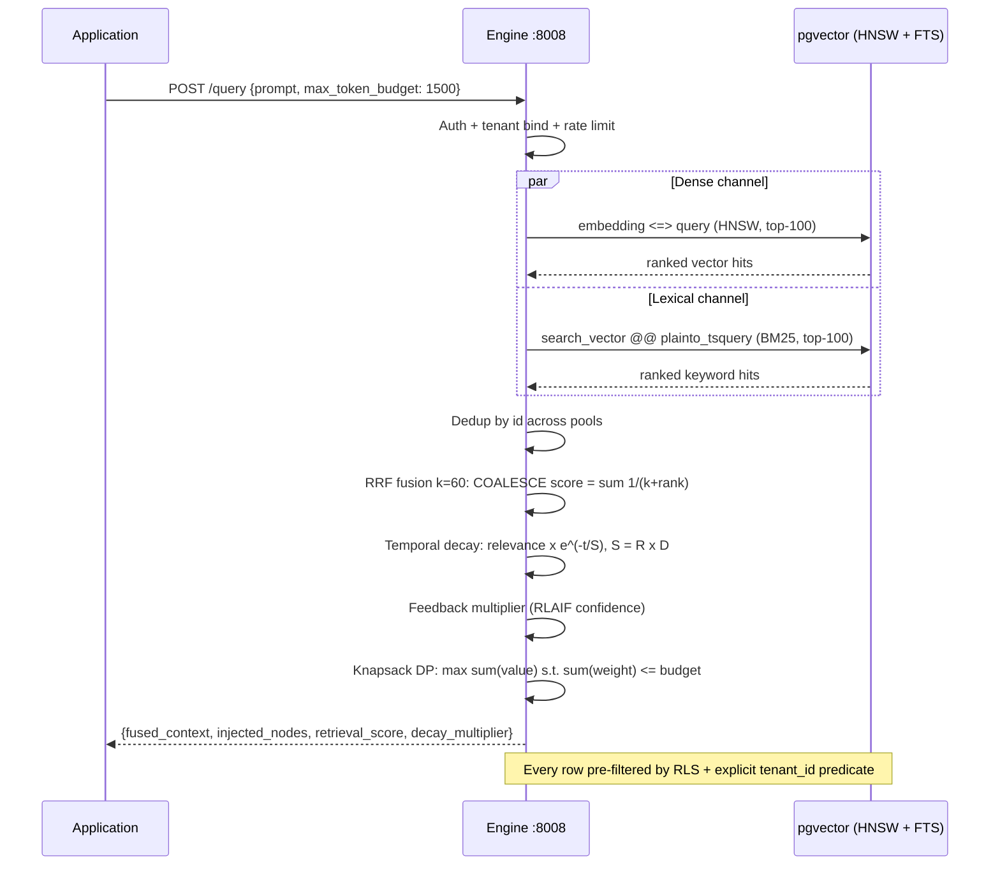
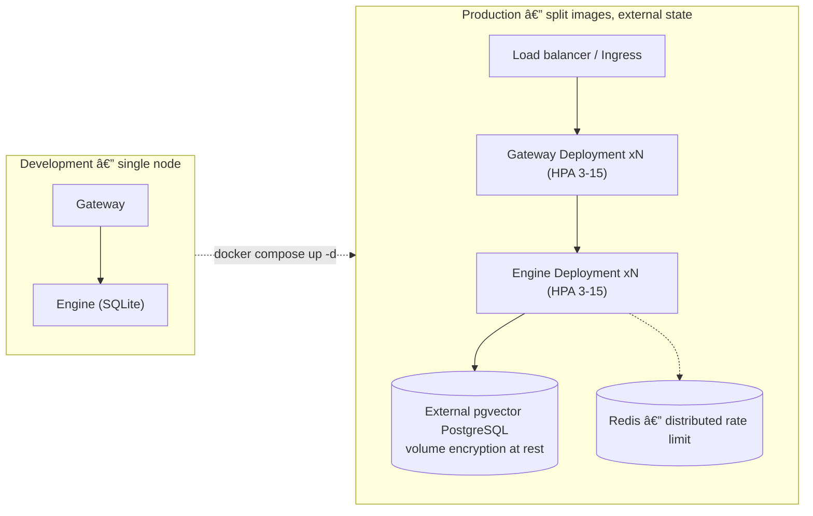
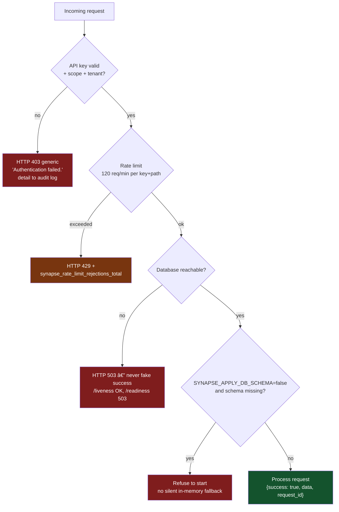
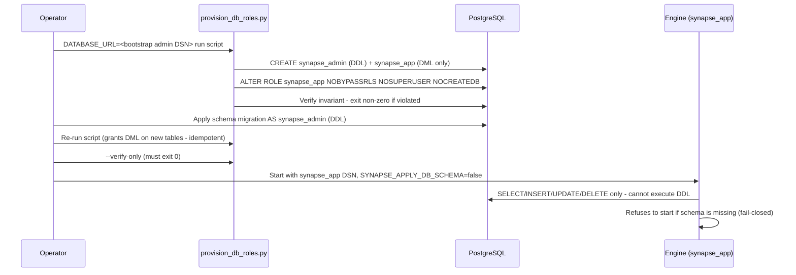
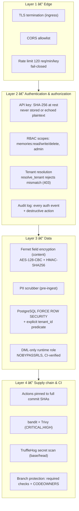
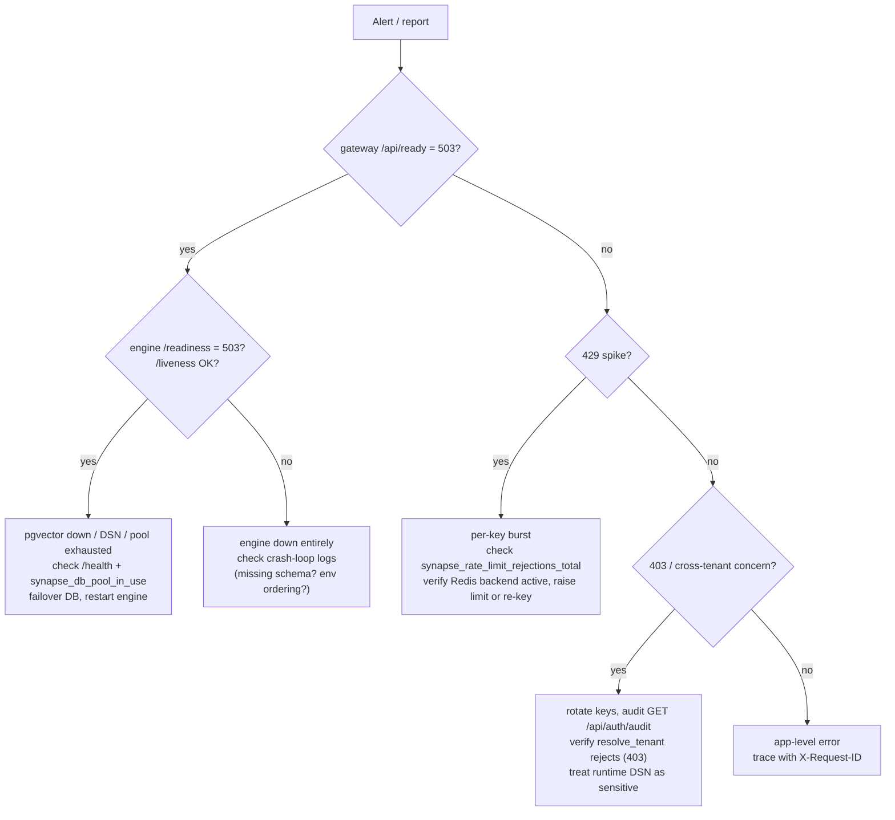
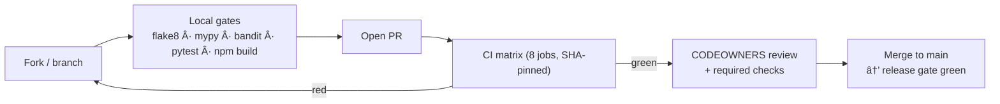

# Synapse Memory

<!-- Automated fix commit -->

<div align="center">

**Enterprise-grade, multi-tenant cognitive memory substrate for LLM applications.**

Field-level encryption on `content` at rest (the `content_plain` search projection is plaintext — see [SECURITY.md](SECURITY.md)) · Hybrid retrieval (BM25 + pgvector HNSW + RRF) · Optimal token packing (0/1 Knapsack DP)
Database-level tenant isolation (PostgreSQL RLS) · Fail-closed paths are covered by tests · Pre-production readiness work ongoing

[](https://github.com/721189/Synapse-Memory/actions/workflows/ci.yml)
[](CHANGELOG.md)
[](https://www.python.org/)
[](https://nodejs.org/)
[](https://github.com/pgvector/pgvector)
[](sdk/python/tests)
[](SECURITY.md)
[](LICENSE)

</div>

---

## Table of Contents

- [1. Executive Summary](#1-executive-summary)
- [2. The Problem](#2-the-problem)
- [3. Architecture](#3-architecture)
  - [3.1 System Topology](#31-system-topology)
  - [3.2 Ingestion Pipeline](#32-ingestion-pipeline)
  - [3.3 Retrieval Pipeline](#33-retrieval-pipeline)
  - [3.4 Deployment Topologies](#34-deployment-topologies)
  - [3.5 Fail-Closed Request Lifecycle](#35-fail-closed-request-lifecycle)
- [4. Core Engines](#4-core-engines)
- [5. Feature Matrix](#5-feature-matrix)
- [6. Quick Start](#6-quick-start)
- [7. Deployment](#7-deployment)
- [8. Configuration Reference](#8-configuration-reference)
- [9. HTTP API Overview](#9-http-api-overview)
- [10. SDK & Framework Integrations](#10-sdk--framework-integrations)
- [11. Security Model](#11-security-model)
- [12. Observability](#12-observability)
- [13. Testing & Quality Gates](#13-testing--quality-gates)
- [14. Performance Baseline](#14-performance-baseline)
- [15. Operations](#15-operations)
- [16. Documentation Index](#16-documentation-index)
- [17. Repository Structure](#17-repository-structure)
- [18. Release History](#18-release-history)
- [19. Contributing](#19-contributing)
- [20. License](#20-license)

---

## 1. Executive Summary

**Synapse Memory** (v1.3.0) is a persistent, encrypted, multi-tenant memory layer that solves the
statelessness of LLM APIs. It ingests text, embeds it, deduplicates it, stores it encrypted, and later
returns **only the most relevant context that fits a finite token budget** — fused across lexical and
dense retrieval, decayed by recency and usage, and packed by dynamic programming instead of naive
truncation.

| | |
|---|---|
| **Status** | Pre-production release. Automated checks cover core behavior and PostgreSQL role isolation, but the latest main CI has deployment failures; review the current Actions status and documented limitations before deployment. The published 1.3.0 artifact predates follow-up fixes being developed on a branch. |
| **Surfaces** | HTTP engine (FastAPI, `:8008`) · Node gateway + React dashboard (`:3000`) · Python SDK (`synapse-memory-engine` 1.3.0) |
| **Storage** | PostgreSQL 16 + pgvector HNSW (production) · SQLite (single-node dev) — both with Fernet field encryption |
| **Integrations** | LangChain · LlamaIndex · raw HTTP (any language) |
| **Deployment** | Docker Compose (4 services) · Kubernetes Helm chart (split engine/gateway + HPA) · bare `uvicorn` |
| **Guarantees** | Database-level tenant isolation (RLS) · fail-closed (no silent fallbacks) · least-privilege DB roles · SHA-pinned CI |
| **Quality gates** | flake8 · mypy (26 files) · bandit · Trivy (CRITICAL,HIGH) · TruffleHog · 150+ pytest · live pgvector integration suite |

---

## 2. The Problem

Every `POST /v1/chat/completions` call is independent. The model has no memory of prior interactions,
and applications that bolt on naive "chat history" hit five hard failure modes:

| # | Requirement | Naive approach fails because… | Synapse Memory solution |
|---|---|---|---|
| 1 | **Retrieve relevant context at scale** | Brute-force similarity scan degrades linearly; keyword-only search misses semantic matches | Hybrid search: BM25 (PostgreSQL FTS) + HNSW vector index in parallel, fused with Reciprocal Rank Fusion (k=60) |
| 2 | **Fit context into a finite window** | Naive truncation drops the most valuable facts for the current prompt | 0/1 Knapsack DP packs memories by `value = relevance × 1000`, `weight = token_cost` — O(n·budget) |
| 3 | **Manage memory lifecycle** | Stale facts never die; duplicates accumulate; confidence never evolves | Ebbinghaus decay `S = R × D` composition, RLAIF feedback multipliers, dual-stage dedup (Jaccard + cosine ≥ 0.85) |
| 4 | **Isolate tenants** | API-level `WHERE tenant_id = ?` is one bug away from a cross-tenant data leak | PostgreSQL `FORCE ROW LEVEL SECURITY` keyed on `app.current_tenant` **plus** explicit SQL predicates — proven by live least-privilege role tests |
| 5 | **Protect data at rest** | TLS protects transit only; a DB dump or leaked backup exposes everything | Fernet (AES-128-CBC + HMAC-SHA256) field-level encryption on `content`, fail-safe on key loss, keys from env/file/KMS. **Scope:** the `content_plain` search projection (and the tsvector/embedding derivatives built from it) is stored in plaintext so lexical/FTS search works — a DB dump or backup therefore still exposes memory text. Rely on DB access controls + volume/backup encryption for that surface, or disable the projection (`SYNAPSE_STORE_SEARCHABLE_PLAINTEXT=false`, lexical search unavailable). Details and residual-risk treatment: [SECURITY.md](SECURITY.md). |

---

## 3. Architecture

### 3.1 System Topology



### 3.2 Ingestion Pipeline



### 3.3 Retrieval Pipeline



### 3.4 Deployment Topologies



| Aspect | Dev topology | Production topology |
|---|---|---|
| Images | combined `Dockerfile` (demo only) | split `Dockerfile.engine` + `Dockerfile.gateway` |
| Storage | SQLite file | External pgvector, RLS enforced |
| DB roles | single owner role, `SYNAPSE_APPLY_DB_SCHEMA=true` | migrate-then-run: migration role (DDL) + `synapse_app` runtime role (DML only, `NOBYPASSRLS`) |
| Rate limiting | in-process window | Redis sorted-set window across all replicas |
| Secrets | `.env` file | Kubernetes Secret / KMS / Vault — never ConfigMap |
| Demo routes | `ENABLE_DEMO_ROUTES=true` | always `false` |

### 3.5 Fail-Closed Request Lifecycle



---

## 4. Core Engines

| Engine | Algorithm | Complexity | Key parameters & behavior |
|---|---|---|---|
| `HybridSearch` | BM25 (PostgreSQL FTS) + cosine (HNSW) fused by Reciprocal Rank Fusion | O(n) per channel | k=60; `COALESCE`-safe per-channel scores (NULL channel never zeroes a hit); top-100 per pool, dedup by id before fusion |
| `KnapsackPacker` | 0/1 dynamic programming with greedy fallback | O(n · budget) | `value = relevance × 1000`, `weight = token_cost`; greedy kicks in when `n × budget > 2M`; hard cap `max_token_budget ≤ 8000` |
| `DecayEngine` | Ebbinghaus forgetting curve × usage strength | O(1) per node | `relevance × e^(−t/S)` with **`S = R × D` composition** (retention × access); `S = 86400 × (1 + access_count × 0.45)`; floor at 0.10; RLAIF feedback adjusts confidence |
| `Deduplicator` | Two-stage: lexical screen → dense verify | O(n) per insert | Jaccard token overlap prefilter, cosine ≥ 0.85 confirms; merges confidence + supersede chain instead of discarding |
| `SecurityManager` | SHA-256 key hashing + Fernet + scope RBAC | O(1) per request | Keys hashed at rest (never stored/returned plaintext); scopes `memories:read/write/delete`, `admin`; tenant from key or `X-Tenant-ID`; full audit trail |
| `RateLimiter` | Redis sorted-set sliding window (Lua) / in-process fallback | O(log n) | 120 req/min per key+path (tunable); Redis outage degrades to per-replica windows — never fails requests |
| `ThreadedConnectionPool` | Thread-safe pool with acquire timeout | O(1) | Rollback-on-return (no transaction leakage); `pool_stats()` exported to `/metrics`; ThreadedConnectionPool for multi-worker safety |
| `PGVectorMemoryStore` | pgvector + HNSW + `FORCE ROW LEVEL SECURITY` | index-assisted | Explicit `tenant_id` predicate **in addition to** RLS; fail-closed on errors; migrate-then-run aware (`apply_schema=False`) |
| `SQLiteMemoryStore` | File-backed SQLite | O(n) | Single-node development only; app-level tenant scoping; same encryption and dedup contracts |

**Formulas at a glance**

```
RRF score       = Σ  1 / (60 + rank_channel)          over available channels (COALESCE-safe)
Decay           = relevance × e^(−t / S),  S = R × D
Confidence'     = confidence × feedback_multiplier      (RLAIF, clamped)
Pack objective  = max Σ value(m)  s.t.  Σ token_cost(m) ≤ budget,  m ∈ candidates
Dedup merge     = Jaccard ≥ threshold  AND  cosine ≥ 0.85  →  merge (confidence ↑, supersede)
```

---

## 5. Feature Matrix

| Category | Capability | Status |
|---|---|---|
| **Retrieval** | Hybrid BM25 + HNSW dense search with RRF fusion (k=60) | ✅ |
| | Token-budgeted context packing via 0/1 Knapsack DP (greedy fallback) | ✅ |
| | Temporal decay `S = R × D` composition preserved through `/query` | ✅ |
| | RLAIF feedback loop (`POST /feedback` adjusts confidence) | ✅ |
| | Dual-stage semantic deduplication with merge/supersede | ✅ |
| **Security** | Fernet field-level encryption (AES-128-CBC + HMAC-SHA256) on `content` | ✅ |
| | SHA-256 hashed API keys, scope RBAC, generic auth errors (no reason leakage) | ✅ |
| | PostgreSQL `FORCE ROW LEVEL SECURITY` + explicit tenant predicates | ✅ |
| | Least-privilege DB roles (DML-only runtime role, `NOBYPASSRLS`, verified in CI) | ✅ |
| | PII scrubbing (emails, phones, SSNs, cards, `sk-*` keys, Aadhaar, PAN) | ✅ |
| | GDPR right-to-erasure (`/api/security/gdpr-delete` with audited `deleted_count`) | ✅ |
| | Distributed rate limiting (Redis) + audit log export (SIEM-ready) | ✅ |
| **Reliability** | Fail-closed: 503 on DB outage, refuse-to-start on missing schema | ✅ |
| | Liveness vs readiness probes (DB-independent vs DB-backed) | ✅ |
| | Thread-safe connection pool, rollback-on-return, pool metrics | ✅ |
| | Idempotent forward-only migrations (schema v4), backup/restore drill | ✅ |
| | Load/resilience suite (concurrency, outages, restarts, bursts — 17 tests) | ✅ |
| **Operations** | Live Prometheus `/metrics` (requests, p50/p95, auth, pool, packing) | ✅ |
| | Split Docker images + Trivy scanning; Helm chart with HPA + Ingress | ✅ |
| | Compose health gating; ops runbook; branch-protection spec | ✅ |
| **Ecosystem** | Python SDK `SynapseClient` (typed, retries, envelope-aware) | ✅ |
| | LangChain & LlamaIndex integrations | ✅ |
| | React dashboard (retrieval, decay, knapsack, security, graph tabs) | ✅ |
| | Docker Compose (4 services) + Kubernetes Helm chart | ✅ |

---

## 6. Quick Start

### 6.1 Docker Compose (recommended — full production-shaped stack)

```bash
git clone https://github.com/721189/Synapse-Memory.git
cd Synapse-Memory
cp deploy/.env.example deploy/.env

# Generate five distinct secrets for deploy/.env:
python -c "import secrets; print('syn_live_' + secrets.token_hex(24))"           # SYNAPSE_API_KEY
python -c "from cryptography.fernet import Fernet; print(Fernet.generate_key().decode())"  # SYNAPSE_ENCRYPTION_KEY
python -c "import secrets; print(secrets.token_urlsafe(32))"                     # POSTGRES_PASSWORD (bootstrap superuser)
python -c "import secrets; print(secrets.token_urlsafe(32))"                     # SYNAPSE_ADMIN_DB_PASSWORD (migration role)
python -c "import secrets; print(secrets.token_urlsafe(32))"                     # SYNAPSE_APP_DB_PASSWORD (runtime role)

# In deploy/.env, also set GEMINI_API_KEY if SYNAPSE_EMBEDDING_PROVIDER=gemini
# (the default), or OPENAI_API_KEY if selecting the OpenAI provider.
# Keep all five generated secrets different. Compose fails closed if any
# required value is missing; the API key and encryption key are not passwords
# for the PostgreSQL bootstrap, migration, or runtime database roles.

docker compose -f deploy/docker-compose.yml up -d
```

**Clean-install path (empty volume).** The engine connects as `synapse_app`, a
least-privilege DML-only runtime role that deliberately **cannot** create the
schema. `docker compose up` therefore runs a one-shot `db-provision` service
first: it creates/repairs the runtime role, applies the schema migrations as the
admin role, and verifies the NON-owner / `NOBYPASSRLS` invariant — then exits 0,
at which point the engine starts. No manual SQL step is needed for Compose.

The equivalent manual step for a managed database (or before a Helm install):

```bash
# Bootstrap credentials remain separate from the migration and runtime roles.
export SYNAPSE_BOOTSTRAP_DATABASE_URL="postgresql://postgres:<bootstrap-password>@host:5432/synapse_cognitive"
export SYNAPSE_MIGRATION_DATABASE_URL="postgresql://synapse_admin:<migration-password>@host:5432/synapse_cognitive"
export SYNAPSE_API_KEY="syn_live_your_generated_key"
export SYNAPSE_ENCRYPTION_KEY="your_generated_fernet_key"
export SYNAPSE_ADMIN_DB_PASSWORD="<migration-password>"
export SYNAPSE_APP_DB_PASSWORD="<runtime-password>"
python scripts/provision_db_roles.py \
  --runtime-role synapse_app --admin-role synapse_admin \
  --runtime-password "$SYNAPSE_APP_DB_PASSWORD" \
  --admin-password "$SYNAPSE_ADMIN_DB_PASSWORD" --apply-migrations
```

| Service | Port | Health probe |
|---|---|---|
| `db-provision` (one-shot roles + migrations) | — | exits 0 |
| `synapse-memory-engine` (FastAPI) | internal `:8008` | `GET /readiness` |
| `synapse-memory-gateway` (dashboard + proxy) | `:3000` | `GET /api/ready` |
| `postgres-pgvector` (pg16) | internal `:5432` | `pg_isready` |
| `redis-state` (Redis 7) | internal `:6379` | `redis-cli ping` |

All health checks are **gated**: the gateway waits for the engine, the engine
waits for `db-provision` to complete successfully, PostgreSQL and Redis. No
service starts against an unhealthy or unmigrated dependency.

### 6.2 Python SDK (5-minute path)

```bash
pip install "synapse-memory-engine[pgvector]"   # production backend
# or: pip install synapse-memory-engine         # SQLite dev backend only
```

```python
from synapse_memory import SynapseClient, SynapseError

with SynapseClient("http://127.0.0.1:8008",
                   api_key="syn_live_your_key",
                   tenant_id="acme") as client:
    created = client.create_memory(
        "The deploy password rotates every 90 days.", category="fact"
    )
    print(created.id, created.status)

    result = client.retrieve("how often does the deploy password rotate?")
    print(result.fused_context)          # packed context within token budget

    try:
        client.retrieve("")
    except SynapseError as e:
        print("handled:", e, "retryable:", e.retryable)
```

### 6.3 curl

```bash
# Ingest
curl -X POST http://localhost:8008/ingest \
  -H "X-Synapse-API-Key: $SYNAPSE_API_KEY" \
  -H "X-Tenant-ID: acme" \
  -H "Content-Type: application/json" \
  -d '{"content": "User prefers TypeScript for backend", "category": "preference"}'

# Query (token-budgeted packed context)
curl -X POST http://localhost:8008/query \
  -H "X-Synapse-API-Key: $SYNAPSE_API_KEY" \
  -H "X-Tenant-ID: acme" \
  -H "Content-Type: application/json" \
  -d '{"prompt": "What language does the user prefer?", "max_token_budget": 1500}'
```

### 6.4 Local development (SQLite, no dependencies)

```bash
pip install -e "sdk/python[all,dev]"
PYTHONPATH=sdk/python uvicorn synapse_memory.api.fastapi_server:app --port 8008
# Omit DATABASE_URL entirely → SQLite backend, app-level tenant scoping.
```

---

## 7. Deployment

### 7.1 Docker Compose

```bash
docker compose -f deploy/docker-compose.yml up -d          # start
docker compose -f deploy/docker-compose.yml ps             # all services healthy?
curl -s localhost:3000/api/ready; curl -s localhost:8008/readiness
```

Key env vars live in **one file**: `deploy/.env` (copy from `deploy/.env.example` — it is the single
source of truth for configuration). Required: `SYNAPSE_API_KEY`, `SYNAPSE_ENCRYPTION_KEY`, `POSTGRES_PASSWORD`.

### 7.2 Kubernetes (Helm)

The chart deploys **only** engine + gateway workloads — PostgreSQL is a documented *external*
dependency (never installed by the chart).

```bash
# 1. Provision pgvector PostgreSQL (managed service or pgvector/pgvector:pg16)
# 2. Create the credentials Secret (see values.yaml → secrets.existingSecret):
kubectl create secret generic synapse-credentials \
  --from-literal=SYNAPSE_API_KEY=... \
  --from-literal=SYNAPSE_ENCRYPTION_KEY=... \
  --from-literal=POSTGRES_PASSWORD=... \
  --from-literal=REDIS_PASSWORD=...

# 3. Migrate-then-run (see 7.3), then install:
helm install synapse deploy/helm-chart \
  --set config.nodeEnv=production \
  --set config.dbHost=<pgvector-host> \
  --set config.applyDbSchema=false \
  --set config.dbUser=synapse_app
```

| Helm resource | Detail |
|---|---|
| Deployments | `engine` + `gateway`, split scaling, non-root containers |
| Services | cluster-IP per workload; gateway derives `PYTHON_ENGINE_URL` from the release fullname |
| HPA | `minReplicas 3` / `maxReplicas 15`, CPU+memory 80% |
| Ingress | optional; TLS termination at ingress recommended |
| Secrets | via existing Secret — **never** ConfigMap; kubelet `$(VAR)` expansion ordering guarded |
| Chart version | `0.1.0` (app 1.3.0) — chart version ≠ app version, see `Chart.yaml` |

### 7.3 Migrate-then-run: least-privilege database roles



```bash
DATABASE_URL=postgresql://<bootstrap-admin>@<host>/<db> python scripts/provision_db_roles.py \
  --runtime-role synapse_app --admin-role synapse_admin \
  --runtime-password "$SYNAPSE_APP_DB_PASSWORD" \
  --admin-password   "$SYNAPSE_ADMIN_DB_PASSWORD"
python scripts/provision_db_roles.py --verify-only   # must exit 0
```

### 7.4 Version compatibility

| Component | Version | Notes |
|---|---|---|
| Python SDK (`synapse-memory-engine`) | **1.3.0** | `SynapseClient`, `__version__ = "1.3.0"` |
| HTTP API compat | **v1** | canonical `{success, data, request_id}` envelope; `/api/*` aliases stable |
| Engine / gateway images | **1.3.0 pair** | must deploy matching tags |
| Helm chart | **0.2.0** (app 1.3.0) | chart version ≠ app version; see `Chart.yaml` |
| Schema | **v4 ledger** | forward-only; v4 adds `content_plain` |
| Python | 3.10 / 3.11 / 3.12 | CI-tested matrix |
| Node.js | ≥ 20.19 (20.x, 22.x in CI) | gateway build matrix |
| PostgreSQL | 16 + pgvector ≥ 0.2 | HNSW index, `tsvector`, RLS |

---

## 8. Configuration Reference

Single source of truth: [`deploy/.env.example`](deploy/.env.example) (compose) and
[`deploy/helm-chart/values.yaml`](deploy/helm-chart/values.yaml) (Kubernetes).

### Secrets (never commit, never in ConfigMap)

| Variable | Required | Description / generation |
|---|---|---|
| `SYNAPSE_API_KEY` | ✅ | Root API key bootstrapped on first start (hashed at rest). `python -c "import secrets; print('syn_live_'+secrets.token_hex(24))"` |
| `SYNAPSE_ENCRYPTION_KEY` | ✅ | Fernet 32-byte urlsafe-base64 data-at-rest key. `python -c "from cryptography.fernet import Fernet; print(Fernet.generate_key().decode())"`. In prod source from KMS/Vault |
| `POSTGRES_PASSWORD` | ✅ (pgvector) | Database password |
| `REDIS_PASSWORD` | optional | Redis auth (may be empty) |
| `GEMINI_API_KEY` / `OPENAI_API_KEY` | optional | Embedding provider keys |

### Storage & schema

| Variable | Default | Description |
|---|---|---|
| `SYNAPSE_STORAGE_BACKEND` | `pgvector` | `pgvector` (team/production) or `sqlite` (single-node dev) |
| `DATABASE_URL` | — | pgvector DSN. When set with `SYNAPSE_ALLOW_DB_FALLBACK=false`, outages fail closed |
| `SYNAPSE_SQLITE_DB_PATH` | `/data/synapse_memory.db` | SQLite path (dev only) |
| `SYNAPSE_APPLY_DB_SCHEMA` | `true` | `true` = engine owns DDL (dev); `false` = migrate-then-run least-privilege production mode — engine **refuses to start** if schema missing |
| `SYNAPSE_ALLOW_DB_FALLBACK` | `false` | `true` ONLY for local dev — silently degrades to in-memory (data loss on restart) |
| `SYNAPSE_APP_DATABASE_URL` | — | Runtime-role DSN for provisioned `synapse_app` |

### Networking & gateway

| Variable | Default | Description |
|---|---|---|
| `GATEWAY_PORT` / `ENGINE_PORT` | `3000` / `8008` | Published ports |
| `PYTHON_ENGINE_URL` | `http://127.0.0.1:8008` | Gateway → engine target (Helm derives it from the release fullname) |
| `ALLOWED_ORIGINS` | `http://localhost:3000,...` | Comma-separated CORS allowlist; `ALLOW_ALL_CORS=true` is dev-only |
| `ENABLE_DEMO_ROUTES` | `false` | **Must be false in production** — gates simulated demo endpoints |
| `NODE_ENV` | `production` | Runtime mode |

### Limits, rate limiting & tuning

| Variable | Default | Description |
|---|---|---|
| `RATE_LIMIT_PER_MIN` | `120` | Per key + path on mutating/heavy-retrieval routes |
| `RATE_LIMIT_WINDOW_SECONDS` | `60` | Sliding-window length |
| `REDIS_URL` | — | When set: distributed Redis sorted-set window across ALL replicas; unset: in-process per replica. Redis outage never fails requests |
| `TOKEN_BUDGET_MAX` | `1500` | Default knapsack budget cap (hard limit 8000) |

### Embeddings (optional)

| Variable | Default | Description |
|---|---|---|
| `SYNAPSE_EMBEDDING_PROVIDER` | `local` | `local` \| `gemini` \| `openai` \| `deterministic` |
| `SYNAPSE_EMBEDDING_MODEL` | `all-MiniLM-L6-v2` | Model name |
| `SYNAPSE_EMBEDDING_DIMENSION` | `384` | Vector dimension (schema/rows must match) |

### Database roles (migrate-then-run)

| Variable | Default | Description |
|---|---|---|
| `SYNAPSE_DB_RUNTIME_ROLE` | `synapse_app` | DML-only runtime role (non-owner, `NOBYPASSRLS`) |
| `SYNAPSE_DB_ADMIN_ROLE` | `synapse_admin` | Migration role (DDL) |
| `SYNAPSE_APP_DB_PASSWORD` / `SYNAPSE_ADMIN_DB_PASSWORD` | — | Role passwords for `scripts/provision_db_roles.py` |

---

## 9. HTTP API Overview

Full contract (every route, schema bound, and error code): **[`docs/api-reference.md`](docs/api-reference.md)**.

**Envelope** — every response carries a request id for end-to-end tracing (pass `X-Request-ID`):

```json
{"success": true,  "data": {...},           "request_id": "…"}
{"success": false, "error": "…",            "request_id": "…"}
```

**Auth:** `X-Synapse-API-Key: <key>` (or `Authorization: Bearer <key>`) on all endpoints except
unauthenticated probes (`/liveness`, `/readiness`, `/health`, `/metrics`). Optional `X-Tenant-ID`
participates in tenant resolution.

### Canonical vs alias paths

| Canonical path | Aliases | Method |
|---|---|---|
| `/api/memories` | `/api/memories/list` | GET |
| `/api/memories/create` | `/ingest`, `/api/memories/add` | POST |
| `/api/memories/query` | `/query`, `/api/retrieval/knapsack-pack` | POST |
| `/api/security/scrub` | `/api/security/scrub-pii` | POST |

### Permission matrix (summary)

| Scope | Endpoints |
|---|---|
| *(none — probes)* | `GET /liveness`, `/readiness`, `/health`, `/metrics` |
| `memories:read` | list, query, scrub |
| `memories:write` | ingest, bulk (≤100 items, 500KB), feedback |
| `memories:delete` | delete, clear, `gdpr-delete` |
| `admin` | key create/list/revoke/rotate, audit read/export/prune |

### Error taxonomy

| Code | Meaning | Retry? |
|---|---|---|
| 400 | Semantic error (empty content, admin tenant missing) | no |
| 401/403 | Auth failure — always generic `"Authentication failed."`; detail in audit log; tenant mismatch = `"Tenant mismatch."` | no |
| 404 | Unknown resource id | no |
| 413 | Bulk payload oversize | no |
| 422 | Pydantic schema violation (field-level detail) | no |
| 429 | Rate limit — `"Rate limit exceeded. Retry after 60s."` | yes, after 60s |
| 503 | DB/provider unavailable — fail-closed, never fake success | yes, with backoff |

---

## 10. SDK & Framework Integrations

### 10.1 Python client (`SynapseClient`)

Typed, envelope-aware, with retries and `retryable` classification on `SynapseError`.

| Method | Signature | Returns |
|---|---|---|
| `create_memory` | `(content, category="interaction", confidence=0.95)` | `CreateResult(id, status, …)` |
| `retrieve` | `(query, max_tokens=1500)` | `QueryResult(fused_context, injected_nodes, …)` |
| `list_memories` | `(limit=50, offset=0)` | paginated dict |
| `delete_memory` | `(memory_id)` | dict |
| `feedback` | `(memory_id, feedback_type)` | dict (adjusts confidence → decay) |
| `health` / `readiness` | `()` | probe dicts |
| `close()` | context manager (`with` supported) | — |

Errors: `SynapseError(message, status=?, retryable=?)` — `retryable=True` on 429/5xx so callers can
back off safely; `400`/`403`/`404` are terminal.

```bash
pip install "synapse-memory-engine[all]"   # everything: pgvector, langchain, llamaindex, redis, local models
```

Optional extras: `[pgvector]`, `[local-models]`, `[redis]`, `[langchain]`, `[llamaindex]`, `[all]`, `[dev]`.

### 10.2 LangChain

```python
from synapse_memory.integrations.langchain import SynapseLangChainMemory

memory = SynapseLangChainMemory(
    tenant_id="acme", memory_manager=manager, searcher=searcher,
    decay=decay, packer=packer, embedder=embedder,
)
memory.save_context(
    inputs={"input": "Capital of France?"},
    outputs={"output": "Paris"},
)
```

### 10.3 LlamaIndex

```python
from synapse_memory.integrations.llamaindex import SynapseLlamaIndexMemory
# Role is normalized ("memory"/"llm") internally — construct with the same
# manager/searcher/decay/packer/embedder wiring as LangChain.
```

### 10.4 Other languages

Any HTTP client works — the contract is just the envelope + API key header
(see [`docs/api-reference.md`](docs/api-reference.md)). The Node gateway (`server.ts`) also exposes
`/api/*` aliases consumed by the React dashboard.

---

## 11. Security Model

Full OWASP API Top 10 (2023) assessment: [`docs/security-review.md`](docs/security-review.md) ·
Policy & disclosure: [`SECURITY.md`](SECURITY.md).



### Controls matrix

| Control | Mechanism | Verified by |
|---|---|---|
| Transport | TLS at ingress; `ALLOWED_ORIGINS` allowlist (no wildcard in prod) | deploy checklist |
| AuthN | SHA-256 hashed API keys; generic 401/403 messages (no reason leakage) | `test_auth_multitenancy.py` |
| AuthZ | Scope RBAC + tenant binding; explicit `tenant_id` in every SQL predicate | `test_required_auth_gateway.py` |
| Tenancy | `FORCE ROW LEVEL SECURITY` on pgvector **+** app-level `resolve_tenant` | live CI job with least-privilege role (`test_pgvector_integration.py`) |
| Least privilege | `provision_db_roles.py`: DML-only runtime role, invariant fails the build | `test_db_role_provisioning.py` |
| Encryption at rest | Fernet field-level on `content` (+ `content_plain` search projection) | `test_encryption.py` |
| PII | Regex scrubbing: emails, phones, SSNs, credit cards, `sk-*`, Aadhaar, PAN | `test_p0_safety_regressions.py` |
| GDPR | `POST /api/security/gdpr-delete` — per-tenant hard delete, audited count | contract tests |
| Abuse control | Redis distributed sliding-window limiter; 429s metricized | `test_rate_limit.py` (14) |
| Secrets hygiene | TruffleHog on push/PR (base..head), SHA-pinned actions | CI `secret-scan` job |
| Vulnerabilities | bandit (Python), Trivy CRITICAL+HIGH (images), mypy strict typing | CI matrix |

### Known limitations (tracked in SECURITY.md)

1. **RLS admin path (fixed in v1.3.0)** — the admin connection now bypasses RLS via `current_user = '<admin_role>'` inside the policy, not a settable GUC sentinel. The app layer remains authoritative for tenant binding (`resolve_tenant` requires an explicit tenant for admin principals). Raising `app.current_tenant` or any other `app.*` GUC can no longer bypass RLS.
2. **Readable derivatives** — embeddings and `tsvector` are derived from plaintext at query time;
   field encryption covers `content`. Treat backup/volume encryption as mandatory.
3. **Retention windows are operator policy** — no background hard-delete job ships; GDPR delete is
   per-tenant explicit.

---

## 12. Observability

### Health & probes

| Probe | Target | Meaning |
|---|---|---|
| `GET /liveness` | engine | Process alive — **DB-independent**, stays OK during an outage (K8s `livenessProbe`) |
| `GET /readiness` | engine | DB + auth usable → 503 when pgvector is down (K8s `readinessProbe`, compose healthcheck) |
| `GET /health` | engine | Telemetry: backend, HNSW, RLS mode, memory count, provider |
| `GET /metrics` | engine | Prometheus text exposition (below) |
| `GET /api/health` | gateway | Gateway liveness |
| `GET /api/ready` | gateway | 503 until engine + auth healthy |

### Prometheus metrics

| Metric | Type | Labels |
|---|---|---|
| `synapse_requests_total` | counter | `path`, `status` |
| `synapse_request_latency_seconds` (+ `_sum`, `_count`) | summary | `path`, `quantile` (0.5 / 0.95, last-500 samples) |
| `synapse_auth_failures_total` / `synapse_rate_limit_rejections_total` | counter | — |
| `synapse_ingest_total` / `synapse_retrieval_total` | counter | `outcome` |
| `synapse_retrieval_candidates` / `synapse_context_tokens_packed` | gauge | — |
| `synapse_memories_total` | gauge | `backend` |
| `synapse_db_pool_in_use` / `synapse_db_pool_size` | gauge | — |
| `synapse_rate_limit_backend` | gauge | `backend="redis"\|"in-process"` |
| `synapse_up` | gauge | — (constant `1`) |

**No hardcoded latency figures exist in the codebase** — read p50/p95 off your own deployment's
`/metrics` before setting SLOs (see [`docs/performance-baseline.md`](docs/performance-baseline.md)).

### Tracing

Pass `X-Request-ID` on any request; it is echoed in the response envelope and threaded through
engine logs, audit entries, and the gateway — one id correlates the whole path.

---

## 13. Testing & Quality Gates

### CI matrix (`.github/workflows/ci.yml`, all actions SHA-pinned)

| Job | What it proves |
|---|---|
| `python-lint-and-type` (3.10 × 3.11 × 3.12) | flake8 clean, mypy strict, bandit clean, **clean module imports** |
| `python-tests` (3.10 × 3.11 × 3.12) | full pytest suite (offline: no network, no external DB) |
| `frontend-build` (Node 20.x × 22.x) | `tsc --noEmit` lint + production Vite bundle |
| `container-build` | monolithic image builds (validation) |
| `python-pgvector-integration-tests` (PG16 service) | **live RLS/tenancy proof**: provision roles → migrate as admin → grant DML → verify invariant → run pgvector suite |
| `split-image-build` | engine + gateway images, compose config valid, **Trivy CRITICAL+HIGH** on both |
| `helm-validate` | `helm lint`, template render, YAML parse + offline contract tests |
| `secret-scan` | TruffleHog across `github.event.before..github.event.after` (push) / base..head (PR) |

### Local gates (mirror CI exactly)

```bash
pip install -r requirements-dev.txt && pip install -e "sdk/python[all,dev]"

PYTHONPATH=sdk/python pytest sdk/python/tests -v      # unit + integration tests; gated tests are reported as skipped
flake8 sdk/python/synapse_memory scripts --config=setup.cfg
mypy sdk/python/synapse_memory --config-file=setup.cfg
bandit -r sdk/python/synapse_memory scripts -s B101,B104,B105,B110,B310,B311,B608
npm ci && npm run lint && npm run build
```

### Test suite map

The suite includes unit, contract, security, resilience and PostgreSQL integration tests. Database- and provider-gated cases must be explicitly enabled in a disposable test environment; passing the default offline suite does not prove every production configuration.

| Suite | Tests | Proves |
|---|---|---|
| `test_load_resilience.py` | 17 | parallel writers/readers lose nothing; DB outage fail-fast + recovery; slow provider degradation; crash-restart durability; 1000-row corpus |
| `test_rate_limit.py` | 14 | limiter behavior incl. window edges |
| `test_db_role_provisioning.py` | 20 | role invariants, idempotency, `--verify-only` |
| `test_helm_chart.py` | 18 | offline Helm rendering contracts (env ordering, split services) |
| `test_p1_contract_regressions.py` | 9 | API envelope, metrics emission, error taxonomy |
| `test_p0_safety_regressions.py` | 4 | P0 regressions incl. PII scrubbing, fail-closed paths |
| `test_pgvector.py` (offline) / `test_pgvector_integration.py` (live CI job) | 3 + 16 | RLS isolation with the **real runtime role** (not just owner) |
| `test_encryption.py`, `test_auth_multitenancy.py`, `test_migrations.py`, and the rest | 63 | engine-by-engine contracts (see §4) |

---

## 14. Performance Baseline

Measured methodology and the 5-step SLO process: [`docs/performance-baseline.md`](docs/performance-baseline.md).

| Layer | Baseline | How it's measured |
|---|---|---|
| Retrieval latency | read live p50/p95 per endpoint from `synapse_request_latency_seconds{path,quantile}` (last-500 window) | your own `/metrics` |
| Packing | DP bounded by `O(n · budget)`; greedy above `n·budget > 2M` | `test_knapsack.py` |
| Dense index | HNSW (pgvector) — sub-linear scan, index-assisted | pgvector CI job |
| Corpus quality | retrieval-eval corpus, **measured-only** (no projections) | `test_retrieval_eval.py` |
| Throughput headroom | bench suite runs offline with projections labeled; treat as upper bounds | `benchmark/bench_suite.py` |
| SLO setting | 5 steps: collect `/metrics` → set p95 target per route → record in baseline doc → alert on `synapse_request_latency_seconds` regressions → re-baseline each release | process, not a number |

> **Policy: no fabricated numbers.** The repo deliberately ships zero hardcoded latency claims —
> every figure must come from a real deployment's telemetry.

---

## 15. Operations

On-call guide: [`docs/ops-runbook.md`](docs/ops-runbook.md) · Backups: [`docs/backup-recovery.md`](docs/backup-recovery.md)

### Incident triage flow



### Quick reference

| Symptom | Likely cause | Action |
|---|---|---|
| Engine crash-loop with `SYNAPSE_APPLY_DB_SCHEMA=false` | schema never migrated | run provision + migration as `synapse_admin`, `--verify-only`, restart — **never** flip `SYNAPSE_ALLOW_DB_FALLBACK=true` in prod |
| `/readiness` 503, `/liveness` OK | DB issue | triage order: `/health` → `/metrics` pool gauges → failover |
| 404 `{simulated: true}` on demo routes | demo routes gated off | expected in prod (`ENABLE_DEMO_ROUTES=false`) |
| Literal `$(DB_PASSWORD)` in DSN after Helm | env ordering edited | `DB_PASSWORD` must precede `DATABASE_URL` in `deployment.yaml` |
| 429 on one tenant | key-level burst | confirm `synapse_rate_limit_backend{backend="redis"}` for multi-replica |

### Scaling

- Engine and gateway scale **independently** (separate Deployments; HPA 3–15).
- Multi-replica rate limiting **requires** `REDIS_URL`; without it the effective limit is
  `RATE_LIMIT_PER_MIN × replicas`.
- Bulk ingest ≤ 100 items / 500KB per call; list endpoints paginate (`limit` ≤ 200);
  `TOKEN_BUDGET_MAX` hard cap 8000.
- Backup/restore: `scripts/backup_restore_drill.py` (drill-tested, CI-covered).

---

## 16. Documentation Index

| Document | Contents |
|---|---|
| [`docs/quickstart.md`](docs/quickstart.md) | 5-minute install → create → retrieve → error handling |
| [`docs/api-reference.md`](docs/api-reference.md) | every route, request/response schema, auth requirement, error codes |
| [`docs/security-review.md`](docs/security-review.md) | OWASP API Top 10 (2023) assessment, API1–API10, controls evidence |
| [`docs/ops-runbook.md`](docs/ops-runbook.md) | on-call: health model, deploy checklist, incident playbooks, scaling |
| [`docs/backup-recovery.md`](docs/backup-recovery.md) | backup strategy + `scripts/backup_restore_drill.py` drill |
| [`docs/performance-baseline.md`](docs/performance-baseline.md) | measured baseline + 5-step SLO process |
| [`docs/production-hardening-baseline.md`](docs/production-hardening-baseline.md) | Historical hardening checklist, known gaps and current verification status |
| [`docs/branch-protection.md`](docs/branch-protection.md) | GitHub rule settings: required checks, CODEOWNERS, stale-dismiss |
| [`docs/publishing.md`](docs/publishing.md) | PyPI release pipeline (`synapse-memory-engine`), trusted publishing, fresh-install guarantee |
| [`SECURITY.md`](SECURITY.md) | threat model, known limitations, vulnerability disclosure |
| [`CHANGELOG.md`](CHANGELOG.md) | release history + compatibility matrix |
| [`CONTRIBUTING.md`](CONTRIBUTING.md) · [`CODE_OF_CONDUCT.md`](CODE_OF_CONDUCT.md) | PR workflow, code of conduct |
| [`CODEOWNERS`](CODEOWNERS) | review ownership for all paths (`@721189`) |

---

## 17. Repository Structure

```
Synapse-Memory/
├── sdk/python/                     # Python package (published as synapse-memory-engine)
│   ├── synapse_memory/
│   │   ├── core/                   # engines: memory_manager, hybrid_search, knapsack_packer,
│   │   │                           # decay_engine, deduplicator, auth, encryption, embedder,
│   │   │                           # sqlite_db, pgvector_db, rate_limiter, observability,
│   │   │                           # pruner, migrations
│   │   ├── api/fastapi_server.py   # HTTP engine :8008 (26 routes, envelope, metrics)
│   │   ├── client.py               # SynapseClient (typed, retries, envelope-aware)
│   │   ├── integrations/           # langchain.py, llamaindex.py
│   │   └── cli/synapse_cli.py      # synapse / synapse-memory entrypoints
│   ├── benchmark/                  # bench_suite.py (offline, projections labeled)
│   └── tests/                      # 23 suites: P0/P1 regressions, load, pgvector, helm, …
├── src/                            # React dashboard (13 tabs: retrieval, decay, knapsack,
│                                   # security, poisoning lab, RLAIFF, graphs, …)
├── server.ts                       # Node gateway :3000 (proxy, CORS, readiness)
├── deploy/
│   ├── docker-compose.yml          # 4 services, health-gated dependencies
│   ├── .env.example                # single source of truth for configuration
│   └── helm-chart/                 # engine+gateway Deployments, HPA, Ingress, NOTES.txt
├── scripts/
│   ├── provision_db_roles.py       # least-privilege roles, invariant verification
│   └── backup_restore_drill.py     # backup/restore drill
├── docs/                           # see §16 Documentation Index
├── examples/knowledge_assistant_api/  # end-to-end example server
├── .github/workflows/ci.yml        # 8-job matrix, SHA-pinned actions
├── Dockerfile.engine / Dockerfile.gateway   # split production images
├── SECURITY.md · CODEOWNERS · CHANGELOG.md
```

---

## 18. Release History

| Version | Date | Highlights |
|---|---|---|
| **1.2.0** | 2026-10-15 | Production-hardening release: NULL-safe RRF, combined-protection encryption (`content` + `content_plain`), `S = R × D` decay composition, fail-closed gateway, thread-safe pooling, Helm split workloads (18 contract tests), load/resilience suite (17 tests), `/metrics`, distributed rate limiting, least-privilege roles, `SynapseClient`, retrieval-eval corpus |
| 1.2.0 (hardening) | 2026-10-16/17 | P0–P2 roadmap closed: RLS live proof with runtime role, SHA-pinned CI, TruffleHog base/head fix, `query_candidates` tenant-scoped PG path, final docs batch (api-reference, security-review, branch-protection, performance-baseline, CODEOWNERS) |
| 0.1.0 | — | Pre-hardening prototype — **do not use in production** |

Open production-readiness work: validate a fresh PostgreSQL/pgvector Compose deployment; measure p95/p99 SLOs on intended hardware and workloads; complete independent security review; and validate real customer usage. See [the current hardening status](docs/production-hardening-baseline.md) and [SECURITY.md](SECURITY.md).

---

## 19. Contributing

1. Read [`CONTRIBUTING.md`](CONTRIBUTING.md) and [`CODE_OF_CONDUCT.md`](CODE_OF_CONDUCT.md).
2. Branch from `main`; all local gates must pass before pushing (§13 commands).
3. CI must be green on your PR — lint/type, tests (3 Python versions), frontend build,
   container scans, Helm validation, secret scan.
4. CODEOWNERS review required; branch protection spec in
   [`docs/branch-protection.md`](docs/branch-protection.md).
5. Keep docs in sync: user-visible changes update `CHANGELOG.md` + relevant `docs/*` page.



---

## 20. License

Proprietary — see [`LICENSE`](LICENSE). Publishing this repository or the PyPI package does **not** grant unrestricted use, deployment, modification, redistribution or hosted-service rights. Obtain written permission or a commercial licence before external use. Licensing contact: `singhshivam20009@gmail.com`.

---

<div align="center">

**Synapse Memory** — *memory infrastructure for persistent, tenant-aware AI applications.*

[Documentation](docs/README.md) · [API Reference](docs/api-reference.md) · [Security](SECURITY.md) ·
[Runbook](docs/ops-runbook.md) · [Changelog](CHANGELOG.md) ·
[Issues](https://github.com/721189/Synapse-Memory/issues)

</div>
