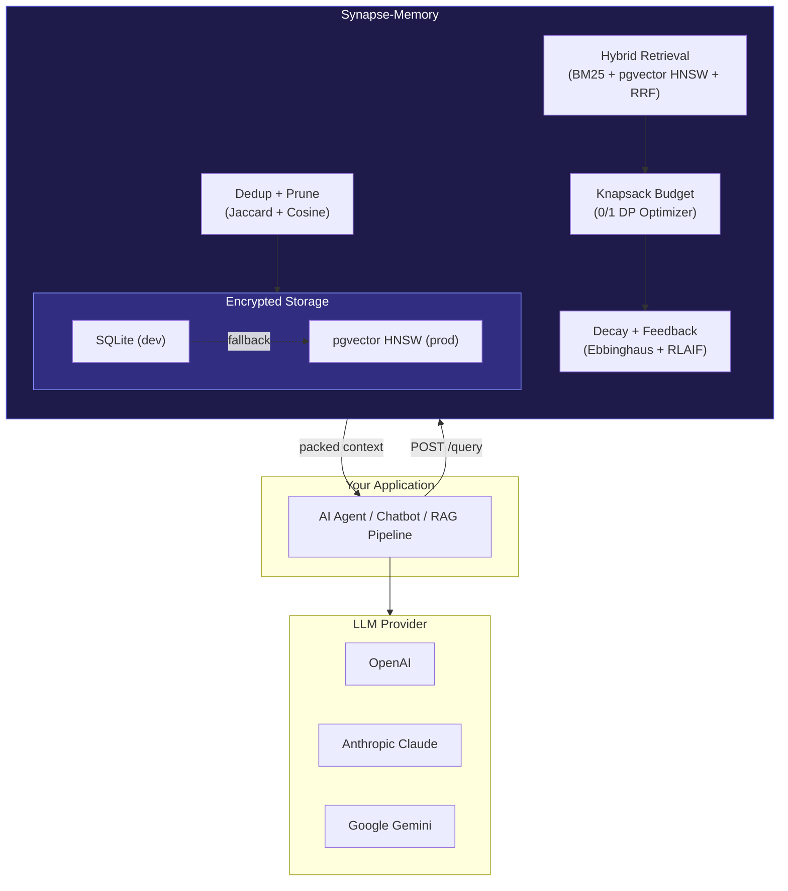
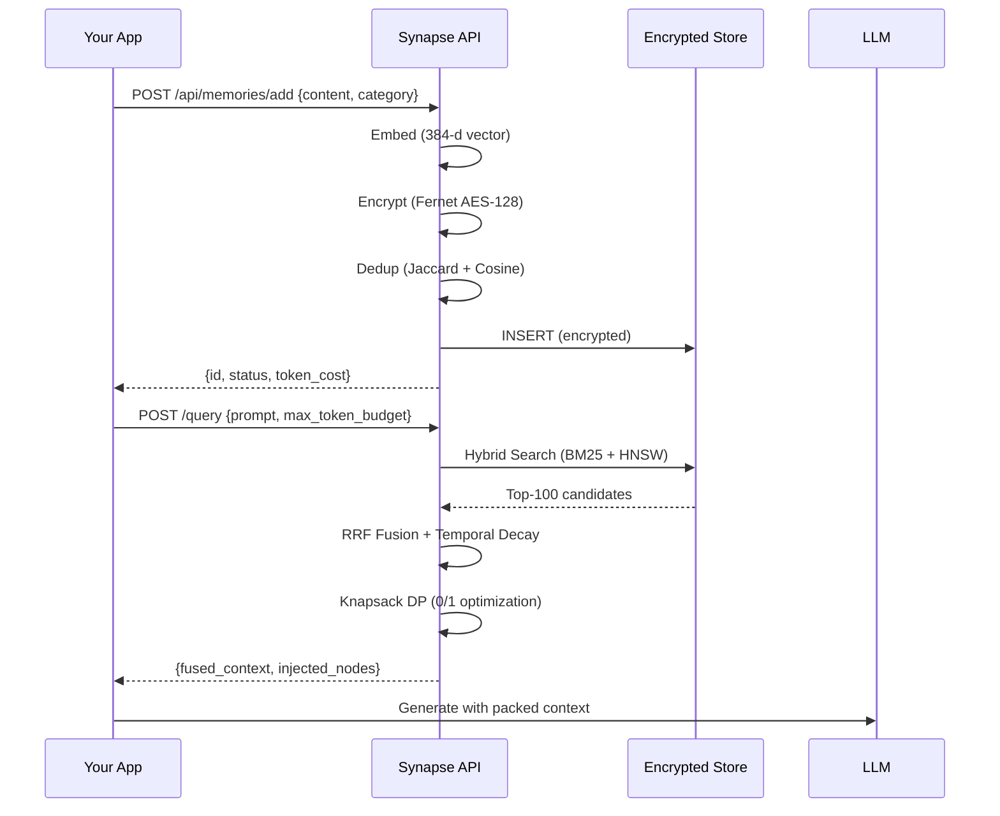

# Synapse Memory

> A sovereign, token-aware cognitive memory substrate for AI agents — DB-level multi-tenancy, Fernet encryption, 0/1 Knapsack DP context budgeting, hybrid retrieval, and Ebbinghaus temporal decay.

[](LICENSE)
[](https://github.com/721189/Synapse-Memory/actions/workflows/ci.yml)
[](https://www.python.org/)
[](https://nodejs.org/)
[](https://github.com/pgvector/pgvector)

---

## What Is This?

Every LLM conversation is stateless — the model forgets everything when the chat ends. **Synapse-Memory is the persistent, encrypted, multi-tenant memory layer** that sits between your application and your LLM so the AI remembers facts, preferences, constraints, and project context across every session.

Think of it as `localStorage` for AI agents — except it's encrypted at the field level, multi-tenant at the database level, and uses optimal algorithms to pack only the most relevant facts into the LLM's finite context window.

### Where It Sits



---

## Architecture

```mermaid
graph LR
    subgraph Input["Ingestion"]
        TXT["Text"]
        DOC["Documents"]
        API["REST / SDK"]
    end

    subgraph Pipeline["Cognitive Pipeline"]
        direction TB
        EMB["Embed<br/>(MiniLM 384-d)"]
        ENC["Encrypt<br/>(Fernet AES-128)"]
        DEDUP["Dedup<br/>(Jaccard + Cosine)"]
        STORE["Store<br/>(pgvector / SQLite)"]
        EMB --> ENC --> DEDUP --> STORE
    end

    subgraph Query["Retrieval Pipeline"]
        direction TB
        QEMB["Query Embed"]
        BM25["BM25 Lexical"]
        VEC["Vector HNSW"]
        RRF["RRF Fusion (k=60)"]
        DECAY["Temporal Decay"]
        KNAP["Knapsack DP"]
        QEMB --> BM25 --> RRF
        QEMB --> VEC --> RRF
        RRF --> DECAY --> KNAP
    end

    Input --> Pipeline
    STORE --> Query
    KNAP -->|"packed context"| LLM["LLM Context Window"]

---

## Quick Start

```bash
git clone https://github.com/721189/Synapse-Memory.git && cd Synapse-Memory
cp deploy/.env.example .env
# Edit .env: SYNAPSE_API_KEY, SYNAPSE_ENCRYPTION_KEY, POSTGRES_PASSWORD
docker compose -f deploy/docker-compose.yml up -d
```

```bash
# Ingest a memory
curl -X POST http://localhost:8008/api/memories/add \
  -H "X-Synapse-API-Key: $SYNAPSE_API_KEY" \
  -H "Content-Type: application/json" \
  -d '{"content": "User prefers TypeScript", "category": "preference"}'

# Query with hybrid search + knapsack budget packing
curl -X POST http://localhost:8008/query \
  -H "X-Synapse-API-Key: $SYNAPSE_API_KEY" \
  -H "Content-Type: application/json" \
  -d '{"prompt": "What language does the user prefer?", "max_token_budget": 500}'
```

---

## Installation

```bash
pip install -e ".[local-models]"    # 384-d MiniLM embeddings
pip install -e ".[pgvector]"        # PostgreSQL + pgvector
pip install -e ".[langchain]"       # LangChain integration
pip install -e ".[llamaindex]"      # LlamaIndex integration
```

---

## API Reference

All responses use the canonical envelope: `{ success, data, request_id }`.

### Memory Operations

| Method | Path | Scope | Description |
|--------|------|-------|-------------|
| POST | `/api/memories/add` | `memories:write` | Ingest (auto-dedup + prune) |
| POST | `/api/memories/query` | `memories:read` | Hybrid search + decay + Knapsack |
| GET | `/api/memories` | `memories:read` | List (`?category=&tenant_id=`) |
| DELETE | `/api/memories/{id}` | `memories:delete` | Delete one |
| POST | `/api/memories/clear` | `memories:delete` | Clear all |
| POST | `/api/memories/bulk-ingest` | `memories:write` | Bulk (≤100) |
| POST | `/feedback` | `memories:write` | RLAIF boost/demote |

### Security & Observability

| Method | Path | Scope | Description |
|--------|------|-------|-------------|
| POST | `/api/auth/keys` | `admin` | Generate key (SHA-256 hashed) |
| GET | `/api/auth/keys` | `admin` | List keys |
| POST | `/api/auth/keys/revoke` | `admin` | Revoke |
| POST | `/api/auth/keys/rotate` | `admin` | Rotate |
| GET | `/api/auth/audit` | `admin` | Audit export |
| POST | `/api/security/scrub-pii` | `memories:read` | Scrub PII |
| POST | `/api/security/gdpr-delete` | `memories:delete` | GDPR delete |
| GET | `/healthz` `/readyz` `/metrics` | none | Probes + Prometheus |

---

## Configuration

| Variable | Default | Description |
|----------|---------|-------------|
| `SYNAPSE_API_KEY` | — | Root admin key (required in prod) |
| `SYNAPSE_ENCRYPTION_KEY` | — | 32-byte Fernet key (required in prod) |
| `DATABASE_URL` | — | PostgreSQL DSN (required in prod) |
| `SYNAPSE_STORAGE_BACKEND` | `auto` | `auto` / `pgvector` / `sqlite` |
| `SYNAPSE_EMBEDDING_PROVIDER` | `local` | `local` / `deterministic` / `gemini` / `openai` |
| `TOKEN_BUDGET_MAX` | `4000` | Knapsack token window cap |
| `RATE_LIMIT_PER_MIN` | `120` | Per-key rate limit |
| `ENABLE_DEMO_ROUTES` | `false` in prod | Simulated demo endpoints |
| `NODE_ENV` | `development` | `production` = strict auth + fail-closed |

---

## Deployment

### Docker Compose

```bash
docker compose -f deploy/docker-compose.yml up -d
```

### Kubernetes (Helm)

```bash
helm install synapse deploy/helm-chart \
  --set config.nodeEnv=production \
  --set secrets.existingSecret=synapse-secrets
```

---

## Framework Integrations

### LangChain

```python
from synapse_memory.integrations.langchain import SynapseMemory
memory = SynapseMemory(
    tenant_id="acme",
    memory_manager=manager, searcher=searcher,
    decay=decay, packer=packer, embedder=embedder
)
memory.save_context(inputs={"input": "Capital of France?"}, outputs={"output": "Paris"})
```

### LlamaIndex

```python
from synapse_memory.integrations.llamaindex import SynapseMemory
```

---

## Security

- **Authentication**: SHA-256 hashed API keys + scope RBAC (`memories:read/write/delete`, `admin`)
- **Multi-tenancy**: DB-level RLS (pgvector) or app-level tenant scoping (SQLite)
- **Encryption**: Fernet (AES-128-CBC + HMAC) field-level; env/file/KMS key management
- **Audit logging**: Every auth event + destructive action logged
- **PII scrubbing**: Emails, phones, SSNs, `sk-*` keys, credit cards

---

## Development

```bash
pip install -r requirements-dev.txt && pip install -e "sdk/python[all,dev]"
PYTHONPATH=sdk/python pytest sdk/python/tests -v
flake8 sdk/python/synapse_memory --config=setup.cfg
mypy sdk/python/synapse_memory --config-file=setup.cfg
bandit -r sdk/python/synapse_memory -s B101,B104,B105,B110,B310,B311,B608
npm ci && npm run lint && npm run build
```

---

## Security Policy

See [SECURITY.md](SECURITY.md) for vulnerability disclosure guidelines.

## License

MIT — see [LICENSE](LICENSE).

    style Pipeline fill:#1e1b4b,stroke:#6366f1,color:#fff
    style Query fill:#1e1b4b,stroke:#818cf8,color:#fff
```

### Data Flow



---

## The 5 Core Engines

| Engine | Algorithm | What It Does |
|--------|-----------|-------------|
| **HybridSearch** | BM25 + Cosine + RRF (k=60) | Searches semantically AND lexically in parallel, fuses results |
| **KnapsackPacker** | 0/1 DP (O(n·budget)) | Packs highest-value memories into token window optimally |
| **DecayEngine** | Ebbinghaus exp(-t/S) | Ages old facts, boosts reinforced ones (RLAIF) |
| **Deduplicator** | Jaccard + Cosine (≥0.85) | Merges semantic duplicates before insert |
| **SecurityManager** | SHA-256 + Fernet | Hashed keys, RBAC scopes, audit logging, tenant isolation |