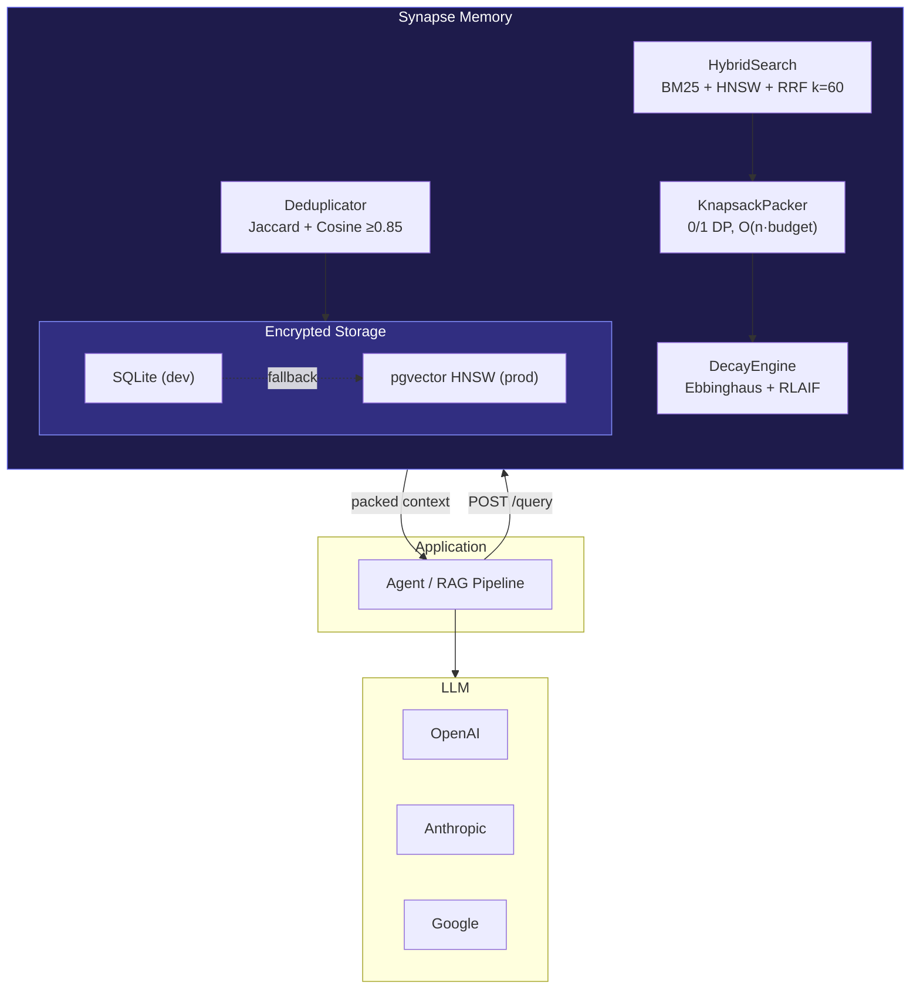
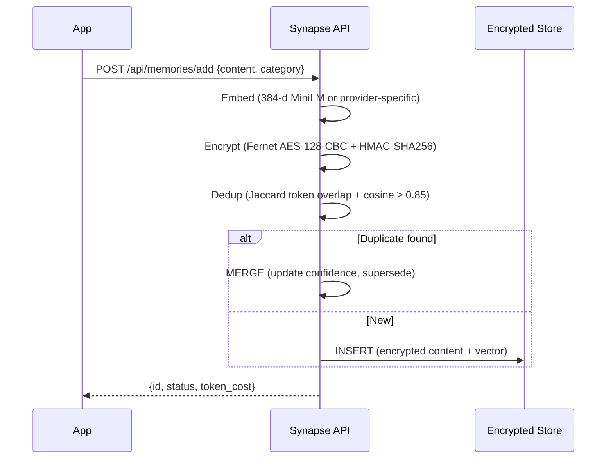
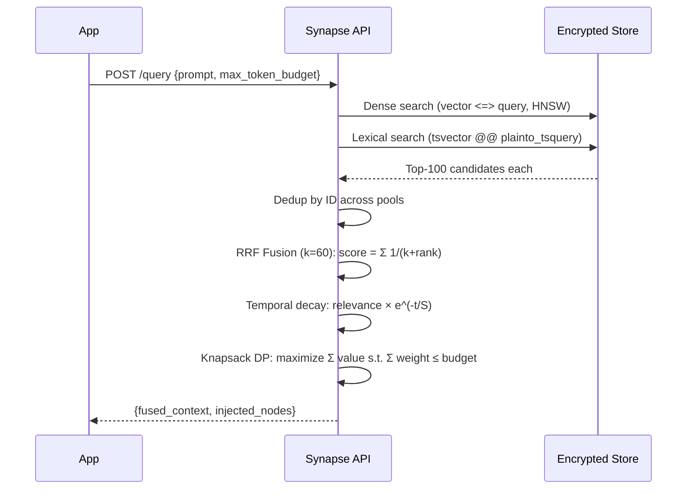

# Synapse Memory

A persistent memory layer for LLM applications. Solves the stateless-LLM problem: models have no memory across sessions. Synapse provides encrypted, multi-tenant, token-budgeted storage with hybrid retrieval (BM25 + pgvector HNSW + RRF) and optimal context packing (0/1 Knapsack DP).

[](https://github.com/721189/Synapse-Memory/actions/workflows/ci.yml)
[](LICENSE)
[](https://www.python.org/)
[](https://nodejs.org/)
[](https://github.com/pgvector/pgvector)

---

## Problem

LLM APIs are stateless. Each `POST /v1/chat/completions` call is independent — no memory of prior interactions. Applications need a persistent store that:

1. **Retrieves relevant context** efficiently at scale (not brute-force scan)
2. **Packs context optimally** into finite token windows (not naive truncation)
3. **Manages memory lifecycle** — decays stale facts, merges duplicates
4. **Isolates tenants** at the database level (not just API-level filtering)
5. **Encrypts at rest** (not just TLS in transit)

Synapse-Memory addresses all five.

---

## Architecture



### Ingestion Pipeline



### Retrieval Pipeline

---

## Quick Start

```bash
git clone https://github.com/721189/Synapse-Memory.git && cd Synapse-Memory
cp deploy/.env.example .env
# Set SYNAPSE_API_KEY, SYNAPSE_ENCRYPTION_KEY, POSTGRES_PASSWORD in .env
docker compose -f deploy/docker-compose.yml up -d
```

```bash
# Ingest
curl -X POST http://localhost:8008/api/memories/add \
  -H "X-Synapse-API-Key: $SYNAPSE_API_KEY" \
  -H "Content-Type: application/json" \
  -d '{"content": "User prefers TypeScript for backend", "category": "preference"}'

# Retrieve with budget packing
curl -X POST http://localhost:8008/query \
  -H "X-Synapse-API-Key: $SYNAPSE_API_KEY" \
  -H "Content-Type: application/json" \
  -d '{"prompt": "What language does the user prefer?", "max_token_budget": 500}'
```

---

## Installation

```bash
pip install -e ".[pgvector]"        # Production (PostgreSQL + pgvector)
pip install -e ".[local-models]"    # Local embeddings (384-d MiniLM)
pip install -e ".[langchain]"       # LangChain BaseMemory
pip install -e ".[llamaindex]"      # LlamaIndex BaseMemory
pip install -e ".[all]"             # Everything
```

Core dependencies: `fastapi`, `pydantic`, `uvicorn`, `cryptography`, `numpy`. Optional: `psycopg2-binary`, `pgvector`, `sentence-transformers`, `langchain-core`, `llama-index-core`.

---

## API

All responses: `{ success: bool, data: <payload>, request_id: string }`.

### Memory

| Method | Path | Scope | Description |
|--------|------|-------|-------------|
| `POST` | `/api/memories/add` | `memories:write` | Ingest (dedup + prune) |
| `POST` | `/api/memories/query` | `memories:read` | Hybrid search + decay + Knapsack |
| `GET` | `/api/memories` | `memories:read` | List (`?category=&tenant_id=`) |
| `DELETE` | `/api/memories/{id}` | `memories:delete` | Delete one |
| `POST` | `/api/memories/clear` | `memories:delete` | Clear all |
| `POST` | `/api/memories/bulk-ingest` | `memories:write` | Bulk (≤ 100) |
| `POST` | `/feedback` | `memories:write` | RLAIF boost/demote |

### Security & Observability

| Method | Path | Scope | Description |
|--------|------|-------|-------------|
| `POST` | `/api/auth/keys` | `admin` | Generate key (SHA-256 hashed) |
| `GET` | `/api/auth/keys` | `admin` | List keys |
| `POST` | `/api/auth/keys/revoke` | `admin` | Revoke |
| `POST` | `/api/auth/keys/rotate` | `admin` | Rotate |
| `GET` | `/api/auth/audit` | `admin` | Audit export |
| `POST` | `/api/security/scrub-pii` | `memories:read` | PII scrubbing |
| `POST` | `/api/security/gdpr-delete` | `memories:delete` | GDPR deletion |
| `GET` | `/healthz` `/readyz` `/metrics` | — | Probes + Prometheus |

---

## Configuration

| Variable | Default | Description |
|----------|---------|-------------|
| `SYNAPSE_API_KEY` | — | Root admin key (required in prod) |
| `SYNAPSE_ENCRYPTION_KEY` | — | 32-byte Fernet key (required in prod) |
| `DATABASE_URL` | — | PostgreSQL DSN (required in prod) |
| `SYNAPSE_STORAGE_BACKEND` | `auto` | `auto` / `pgvector` / `sqlite` |
| `SYNAPSE_EMBEDDING_PROVIDER` | `local` | `local` / `deterministic` / `gemini` / `openai` |
| `TOKEN_BUDGET_MAX` | `4000` | Knapsack token window cap |
| `RATE_LIMIT_PER_MIN` | `120` | Per-key rate limit |
| `REDIS_URL` | — | Redis DSN; enables cross-replica rate limiting (else in-process) |
| `ENABLE_DEMO_ROUTES` | `false` in prod | Simulated demo endpoints |
| `NODE_ENV` | `development` | `production` = strict auth + fail-closed |
| `SYNAPSE_APPLY_DB_SCHEMA` | `true` | `false` = migrate-then-run: run the engine as a DML-only runtime role (see `SECURITY.md`) |

---

## Deployment

```bash
docker compose -f deploy/docker-compose.yml up -d
helm install synapse deploy/helm-chart --set config.nodeEnv=production
```

---

## Framework Integrations

```python
# LangChain
from synapse_memory.integrations.langchain import SynapseMemory
memory = SynapseMemory(tenant_id="acme", memory_manager=manager, searcher=searcher, decay=decay, packer=packer, embedder=embedder)
memory.save_context(inputs={"input": "Capital of France?"}, outputs={"output": "Paris"})

# LlamaIndex
from synapse_memory.integrations.llamaindex import SynapseMemory
```

---

## Security Model

- **Auth**: SHA-256 hashed API keys, scope RBAC (`memories:read/write/delete`, `admin`)
- **Multi-tenancy**: DB-level RLS (pgvector) or app-level scoping (SQLite)
- **Encryption**: Fernet (AES-128-CBC + HMAC-SHA256) field-level; env/file/KMS key management
- **Audit**: Every auth event + destructive action logged
- **PII**: Regex scrubbing for emails, phones, SSNs, `sk-*` keys, credit cards

---

## Testing & Quality

```bash
pip install -r requirements-dev.txt && pip install -e "sdk/python[all,dev]"
PYTHONPATH=sdk/python pytest sdk/python/tests -v
flake8 sdk/python/synapse_memory --config=setup.cfg
mypy sdk/python/synapse_memory --config-file=setup.cfg
bandit -r sdk/python/synapse_memory -s B101,B104,B105,B110,B310,B311,B608
npm ci && npm run lint && npm run build
```

---

## Security Policy

See [SECURITY.md](SECURITY.md).

## License

MIT — see [LICENSE](LICENSE).



---

## Core Engines

| Engine | Algorithm | Complexity | Notes |
|--------|-----------|-----------|-------|
| `HybridSearch` | BM25 + Cosine + RRF (k=60) | O(n) per pool | Dense and lexical in parallel, fused by reciprocal rank |
| `KnapsackPacker` | 0/1 DP | O(n · budget) | Greedy fallback when n·budget > 2M; `value = relevance × 1000`, `weight = token_cost` |
| `DecayEngine` | `relevance × e^(-t/S)` | O(1) per node | `S = 86400 × (1 + access_count × 0.45)`; floor at 0.10; RLAIF feedback adjusts confidence |
| `Deduplicator` | Jaccard + Cosine | O(n) per insert | Dual-stage: lexical screening → dense verification (≥ 0.85 threshold) |
| `SecurityManager` | SHA-256 + Fernet | O(1) per request | API keys hashed at rest; RBAC scopes; audit log; tenant from key or `X-Tenant-ID` |